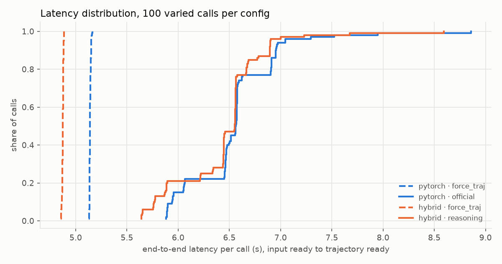
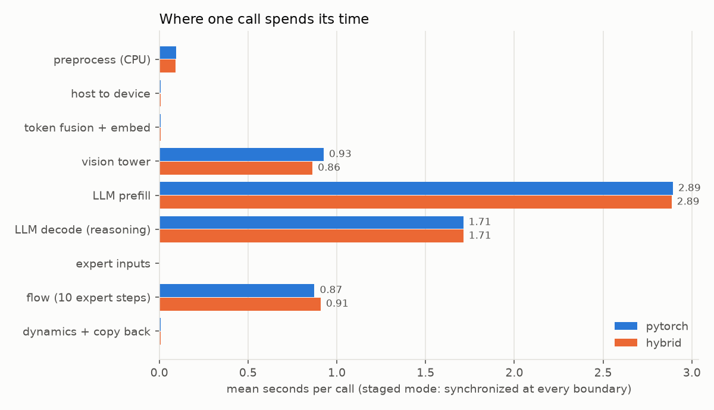
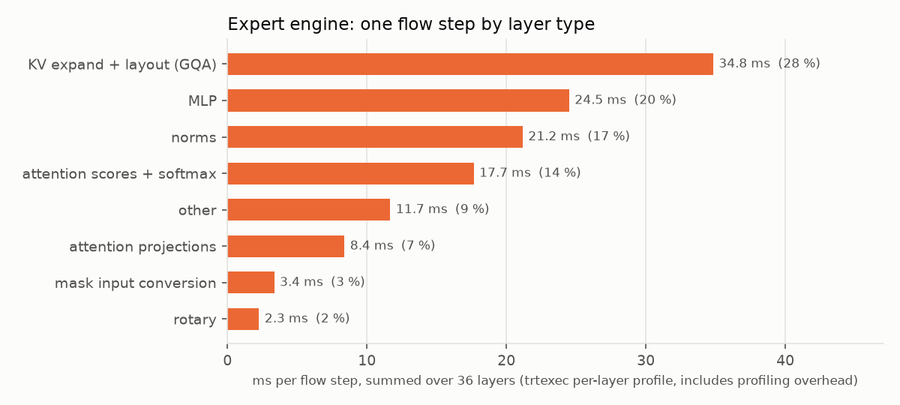
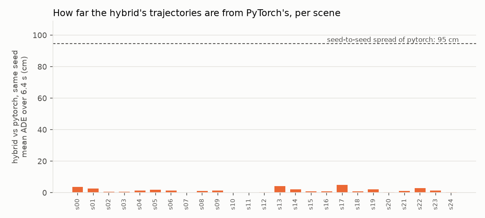
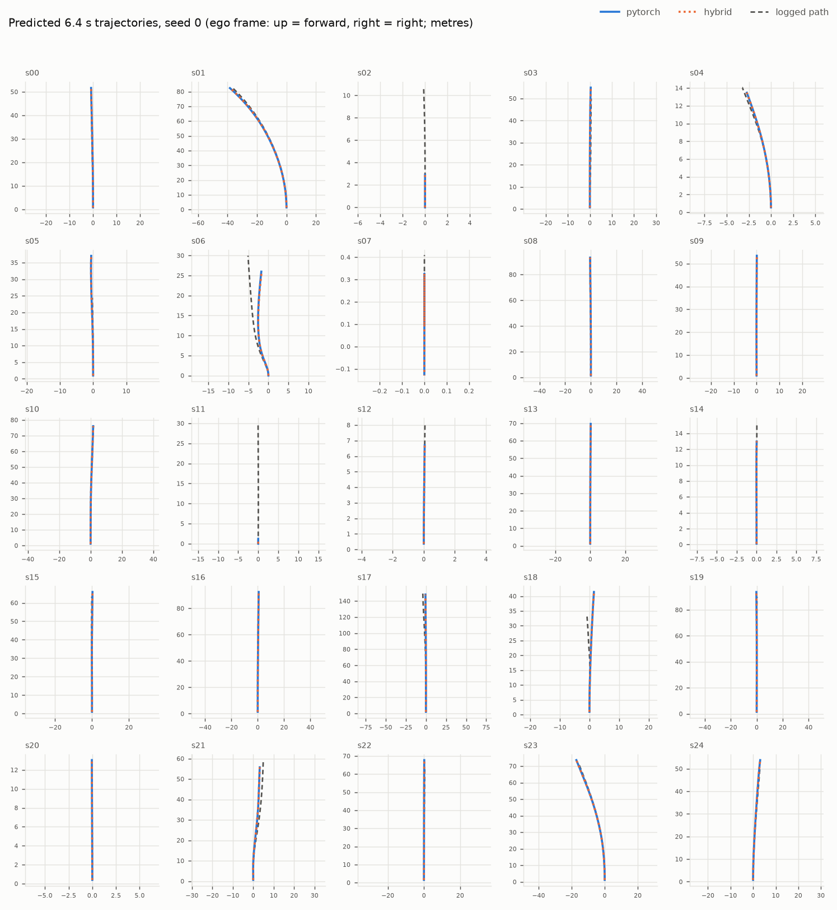

# Alpamayo 1.5 on Jetson AGX Orin: PyTorch vs TensorRT 8.5 hybrid

Device: Jetson AGX Orin, L4T R35.2.1, power mode MAXN, GPU 1300.5 MHz. torch 2.8.0, transformers 4.57.1.

Runs: `20261104-015615_pytorch` (pytorch) and `20261104-044346_hybrid` (hybrid). Latency is from input ready (decoded frames and ego history in host memory) to trajectory ready (copied back to the host).

## Latency

| backend | config | n | p50 ms | p95 ms | p99 ms | max ms | tokens generated (mean) | reasoning complete | trajectory emitted |
|---|---|---|---|---|---|---|---|---|---|
| pytorch | force_traj | 100 | 5,139 | 5,152 | 5,159 | 5,164 | 2.0 | 0 % | 100 % |
| pytorch | official | 100 | 6,563 | 7,044 | 7,959 | 8,858 | 15.9 | 100 % | 100 % |
| hybrid | force_traj | 100 | 4,875 | 4,883 | 4,888 | 4,888 | 2.0 | 0 % | 100 % |
| hybrid | reasoning | 100 | 6,553 | 6,900 | 7,683 | 8,592 | 15.9 | 100 % | 100 % |

## Where the time goes

Staged calls synchronize the GPU at every stage boundary, so the stages add up to the call.

| stage | pytorch ms | hybrid ms | share of hybrid call |
|---|---|---|---|
| preprocess (CPU) | 95 | 93 | 1 % |
| host to device | 9 | 9 | 0 % |
| token fusion + embed | 7 | 7 | 0 % |
| vision tower | 926 | 863 | 13 % |
| LLM prefill | 2,893 | 2,886 | 44 % |
| LLM decode (reasoning) | 1,712 | 1,713 | 26 % |
| expert inputs | 2 | 2 | 0 % |
| flow (10 expert steps) | 874 | 909 | 14 % |
| dynamics + copy back | 9 | 9 | 0 % |

Decode, per generated token (p50): pytorch 112.4 ms, hybrid 112.4 ms. Time to first token (mean): pytorch 3,893 ms, hybrid 3,837 ms.

## TensorRT engines

| engine | GPU compute median ms | with CUDA graph ms | parity gate |
|---|---|---|---|
| vision | 865.6 | 870.0 | passed |
| expert | 96.3 | 88.9 | passed |

The vision engine is 12 profiled nodes; TensorRT fuses the 27 transformer blocks into one node (852 of 867 ms), so it cannot be split by layer type.

## Outputs: hybrid vs PyTorch

| pytorch config | hybrid config | scene/seed pairs | identical reasoning | trajectory distance, mean ADE 6.4 s | max | seed-to-seed spread (pytorch) | error vs logged path, pytorch -> hybrid |
|---|---|---|---|---|---|---|---|
| official | reasoning | 100 | 100 % | 1.5 cm | 9.2 cm | 95 cm | 1.534 -> 1.536 m |
| force_traj | force_traj | 100 | 100 % | 1.4 cm | 10.0 cm | 96 cm | 1.566 -> 1.569 m |

## Memory

| backend | system RAM used, peak (incl. /dev/shm) | of which /dev/shm at load | PyTorch allocator peak |
|---|---|---|---|
| pytorch | 52.0 GiB | 20.7 GiB | 23.3 GiB |
| hybrid | 40.3 GiB | 26.1 GiB | 17.5 GiB |

The hybrid run used `--drop-weights-after-load`: its peak is after the checkpoint copy in `/dev/shm` was deleted, leaving
the 5.8 GB of engines there. The pytorch run kept its checkpoint copy (no engines).

## How this run was made

Every step used the kit's own scripts and files, starting from an empty `/dev/shm` on a stock Jetson AGX Orin 64 GB
(JetPack 5.1, L4T R35.2.1, TensorRT 8.5.2) whose eMMC had 1 GB free, so everything lived in RAM.

| Step | Result |
|---|---|
| `preflight.sh` | 0 FAIL |
| `export_onnx.sh` (workstation, CPU) | vision and expert ONNX byte-identical to `checksums/onnx.sha256` (371 + 333 files); vision references byte-identical to `checksums/parity.sha256` |
| checkpoint, downloaded on the Orin; `verify_artifacts.sh weights scenes` | all files match |
| `run.sh pytorch` | 2 configs x (100 timed calls + 25 scenes x 4 seeds) |
| `capture_expert_refs.sh` | padded vs unpadded float32: 1e-7 / 3e-7; BF16 vs float32: 0.0033 / 0.0026 |
| `build_engines.sh` (fresh builds: vision 9 min, expert 20 min) | vision gate: deepstack relative L2 0.009-0.023; expert gate: 0.0025 / 0.0018 vs float32, identical after CUDA-graph replay |
| `run.sh hybrid --drop-weights-after-load` | 2 configs x (100 timed calls + 25 scenes x 4 seeds); compared with the pytorch run automatically |

The only pre-existing pieces were a Python 3.12 venv with the PyTorch 2.8.0 wheel that `setup_venv.sh` builds (the device
has no disk to build it again) and the Hugging Face cache of the `Qwen/Qwen3-VL-2B-Instruct` processor.

## Bottlenecks

**The LLM is the bottleneck: 70 % of a call, and it runs in PyTorch in both backends.** The hybrid moves vision and the
expert to TensorRT, which together are 27 % of the call, and saves 10 ms (0.15 %) at the median. TensorRT vision saves
63 ms; the TensorRT expert loses 35 ms against PyTorch's CUDA-graph expert.

How far each stage is from what the hardware allows. Parameter counts are from the checkpoint. The Orin's memory bandwidth
is 204.8 GB/s (LPDDR5). Its FP16 tensor-core throughput at 1,300.5 MHz measures 25-29 TFLOP/s on large GEMMs in earlier
work on this device. These are estimates of the floor, not measurements:

| Stage | Measured | Work | Floor | Efficiency | Bound by |
|---|---|---|---|---|---|
| LLM prefill (3,086 tokens, 36 layers, 6.95 B params) | 2,886 ms | ~45.7 TFLOP (42.9 matmul + 2.8 causal attention) | ~1,700 ms at 27 TFLOP/s | ~60 % | compute |
| LLM decode, per token (7.58 B params incl. lm_head + ~0.46 GB KV) | 112 ms | ~15.6 GB read | ~76 ms at 204.8 GB/s | ~68 % | memory bandwidth |
| Vision tower (0.58 B params, 11,520 patches) | 863 ms | ~14.3 TFLOP | ~530 ms at 27 TFLOP/s | ~61 % | compute |
| Expert, per flow step (2.28 B params, 64 queries over 3,136 KV) | 89-96 ms | ~4.6 GB weights + ~0.5 GB KV; ~0.3 TFLOP | ~25 ms at 204.8 GB/s | ~27 % | overheads (below) |

Prefill, decode and vision already run at 60-70 % of the device's limits. Kernels alone won't make them much faster: the
work has to shrink. Fewer image tokens shrink vision and prefill (prefill grows faster than linearly with tokens). Fewer
reasoning tokens shrink decode, as `force_traj` shows: no reasoning saves 1.4 s (pytorch) to 1.7 s (hybrid), but it is
not behavior-preserving.
Lower-precision weights shrink decode, which is bandwidth-bound: 8-bit weights would halve the bytes per token. They are
not part of this kit, and their effect on outputs would need the same validation as the engines.

**The expert is the one stage far from its floor** (~3.6x). The per-layer profile shows where one flow step goes:

* **KV expand and layout for grouped-query attention, 28 %.** The exported attention repeats the 8 KV heads to 16 and
  transposes them, over all 3,136 cached tokens, at every one of the 10 flow steps. The cache is the same for all 10
  steps. Native GQA attention, or expanding the cache once per call, removes most of this. Earlier work measured native
  GQA in PyTorch at 6,355 vs 6,575 ms p50.
* **Norms, 17 %.** Part of this is the FP16-safe rescaling (an extra max reduction per RMSNorm), which the engine needs
  to stay valid in FP16.
* **Mask input conversion, 3 %** (3.4 ms per step). The float32 attention mask is converted to FP16 at every step,
  although it is constant within a call. Passing it as FP16 removes this.

Together these are at most about 0.4 s of the expert's 0.9 s per call (only part of the norm time is avoidable). Even
fully removed, the call would still take about 6.1 s, because of the LLM.

**What would change the picture.** Neither backend comes near a 100 ms or 1 s deadline with this 10 B model. The tested
TensorRT 8.5 path for the LLM (stock kernels) was slower than PyTorch in earlier work, and a flash-attention plugin
helped only the attention part of prefill. TensorRT Edge-LLM, which targets LLMs on Jetson, needs JetPack 6.2 or newer.
